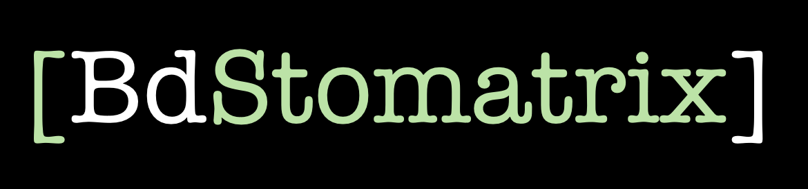
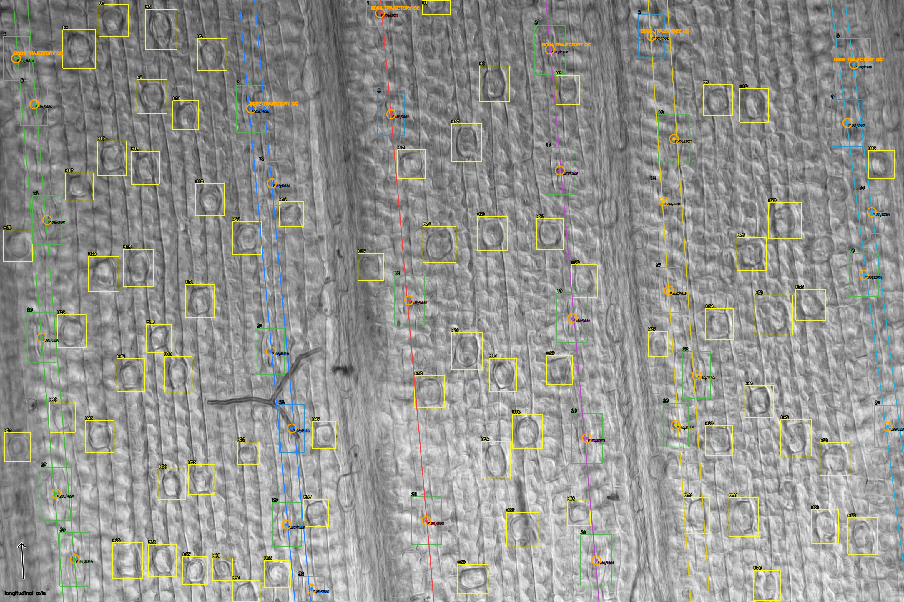
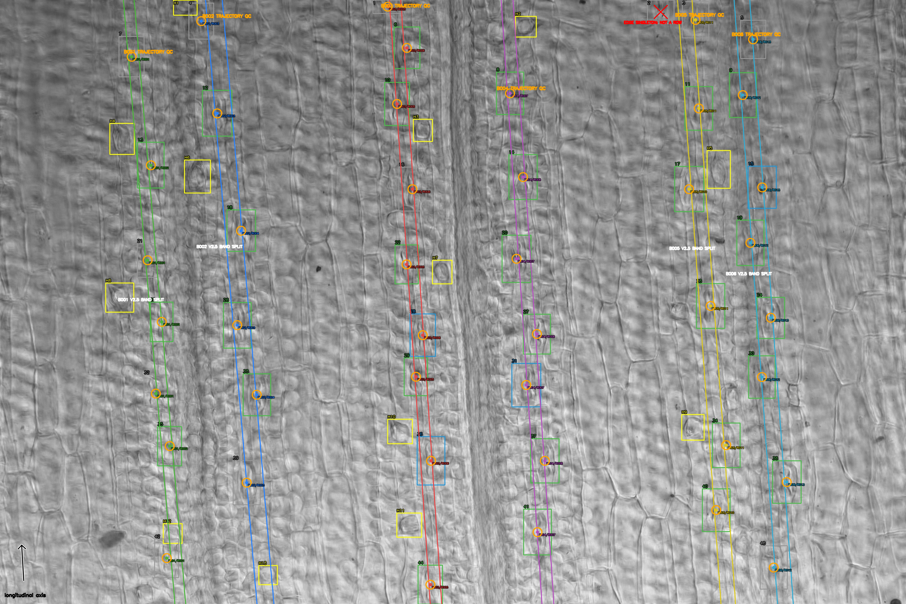
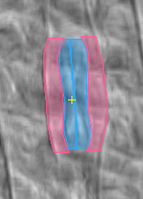
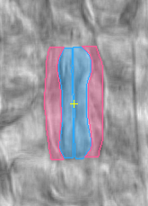
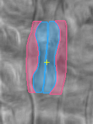
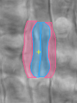

# BdStomatrix (v1.1.0)



BdStomatrix uses Brachypodium OME-TIFF leaf epidermal microscopic images to 
extract density, morphometry, row and band stomatal phenotypes.

BdStomatrix runs a detector, a classifier and a segmentor to detect stomata and
extract the guard-cell and subsidiary-cell masks. These masks and detected 
bounding boxes serve as input for the trait extractor.

IMPORTANT - The pipeline is currently trained on 20x Differential Interference
Contrast (DIC) images and has not been tested on magnified or non-DIC images. 

This release has one production entry point (complete pipeline) and one 
self-contained trait extractor:

- `run_bdstomatrix.py`: complete inference-to-traits workflow for either one
  TIFF or a directory.
- `trait_extractor.py`: standalone trait extraction from an
  existing BdStomatrix inference directory.

The trait extractor has no external extractor-module dependency. It embeds
the 16 audited historical source modules byte-for-byte, verifies their hashes,
and materializes them only in a private temporary directory for the current
process. This preserves the validated inherited behavior while providing one
deployable extractor file.

## Readable source code

The `scripts/` directory contains the 16 readable Python source modules used
to implement the audited trait-extraction workflow.

`trait_extractor.py` is the portable production bundle. It contains compressed
copies of these modules and verifies their SHA-256 identities before executing
them. The readable scripts are provided for scientific review, transparency
and future development; they are not required when running the bundled
production pipeline.

The readable modules and embedded modules belong to the same locked scientific
trait-rule version, v2.5.4. Any future modification to a readable module must
use a new version and regenerate the bundled `trait_extractor.py`; editing only
one representation would break their verified equivalence.

The final rule implementation is:

`scripts/extract_traits_from_pipeline_output_v2_5_4_independent_band_boundary_rules.py`

Earlier modules are retained because v2.5.4 inherits their audited
functionality.

## Version identity

- BdStomatrix application and release: `1.1.0`
- Single-file trait-extractor distribution bundle: `1.1.0`
- Audited scientific trait-rule version: `2.5.4`

The application version identifies this GitHub release. The scientific
trait-rule version remains separately recorded in provenance and output naming
so analytical changes can be distinguished from packaging changes.

## Production behavior

- Accepts one TIFF file or one directory through the same command.
- Verifies all Python components, embedded extractor sources and model weights.
- Defaults to strict reference-calibration QC, with an explicit option to use
  valid per-image OME calibration while recording a mismatch warning.
- Supports CPU, Apple MPS and indexed NVIDIA CUDA execution.
- Defaults to the validated 3072 x 2048 dimensions while allowing an explicit
  alternative expected width and height.
- Creates annotated spatial row/band audit overlays.
- Does not create duplicate top-level batch trait CSV files.
- Removes detector overview JPEGs after successful extraction by default.
- Retains inference manifests, compressed masks, masked-crop QC references
  and provenance needed for reproducibility.
- Never modifies source TIFF files.
- Refuses to overwrite an existing output directory.

## Tested input contract

- File extension: `.ome.tif`, `.ome.tiff`, `.tif` or `.tiff`.
- Default image dimensions: 3072 x 2048 pixels. Other dimensions must be
  supplied explicitly and represent a new image domain requiring audit.
- Image type: unsigned 8-bit grayscale.
- Filename begins with `S001_AB_P1_...` or `S001_P1_AB_...`.
- OME metadata contains valid positive X/Y physical pixel dimensions.
- Strict mode additionally requires isotropic metadata matching the locked
  4.5848 pixels/µm reference within 0.001 pixels/µm.

## Run one image

```bash
python -B run_bdstomatrix.py \
--input "/full/path/to/S001_AB_P1_EDF.ome.tif" \
--output-dir "/full/path/to/S001_AB_P1_BdStomatrix_final" \
--device mps
```

## Run a directory

```bash
python -B run_bdstomatrix.py \
--input "/full/path/to/ome_tiff_directory" \
--output-dir "/full/path/to/cohort_BdStomatrix_final" \
--device mps
```

Add `--recursive` only when nested directories should be searched. Reduce
`--classifier-batch-size` from 32 to 16 or 8 if accelerator memory is limited.
Use `--device cpu`, `--device mps`, or `--device cuda --cuda-device 0`.

`--keep-inference-overviews` retains detector overview JPEGs. These are
removed by default because the spatial row/band audit overlays are retained.

## Non-default resolution

Both dimensions must describe the actual input images:

```bash
python run_bdstomatrix.py \
--input "/full/path/to/images" \
--output-dir "/full/path/to/new_output" \
--expected-image-width 4096 \
--expected-image-height 3072 \
--device cpu
```

Changing dimensions does not retrain the models. Audit detections,
segmentations and spatial overlays before using traits from a new image domain.

## Calibration policies

The default preserves the validated behavior:

```text
--calibration-policy strict-reference
```

It requires valid isotropic OME metadata matching 4.5848 pixels/µm within the
0.001 tolerance. Trait calculations use the actual metadata values after the
image passes this check.

To use valid per-image metadata despite disagreement with the reference:

```text
--calibration-policy use-image-metadata
```

This permits positive X/Y metadata values, uses them separately for calibrated
traits, and records `metadata_used_reference_mismatch` or
`metadata_used_anisotropic_calibration`, the actual calibration, differences,
and a provisional warning. Missing or invalid calibration still stops the
complete pipeline.

## Run trait extraction alone

```bash
python -B trait_extractor.py \
--pipeline-output-dir "/full/path/to/inference_support" \
--output-dir "/full/path/to/new_traits_v2_5_4"
```

The trait output must be new and outside the inference directory.

## Output layout

```text
<output-root>/
├── inference_support/
│   ├── input_image_manifest.csv
│   ├── stoma_segmentation_manifest.csv
│   ├── hair_cell_detection_manifest.csv
│   ├── selected_mask_instances.csv
│   ├── image_pipeline_summary.csv
│   ├── masks/
│   ├── masked_crops/
│   └── pipeline_provenance.json
├── traits_v2_5_4/
│   ├── stoma_traits.csv
│   ├── image_traits.csv
│   ├── image_gwas_traits.csv
│   ├── cell_instance_traits_qc.csv
│   ├── row_traits_qc.csv
│   ├── band_traits_qc.csv
│   ├── spatial_audit_overlays/
│   └── trait_extraction_provenance.json
├── final_run_provenance.json
└── FINAL_RUN_REPORT.txt
```

## Example outputs

The following representative abaxial and adaxial outputs come from
the completed Conda verification run. Public example filenames are generic;
the image content has not been altered.

### Spatial audit overlays

#### Abaxial surface



#### Adaxial surface



### Masked stomatal-complex crops

Each crop below passed the preliminary complete-complex checks and contains
two selected guard-cell masks and two selected subsidiary-cell masks.

#### Abaxial masked crops

| Stoma 0011 | Stoma 0019 |
| --- | --- |
|  |  |

#### Adaxial masked crops

| Stoma 0008 | Stoma 0017 |
| --- | --- |
|  |  |

### Spatial-overlay and mask colour key

The spatial audit overlay is drawn on the detector overview, so it contains
both inference-stage boxes and trait-extraction annotations. Colour must be
read together with mark shape and adjacent text: some colours are deliberately
reused for different mark types. The key below includes every annotation that
the final v2.5.4 renderer can emit, including marks absent from these two
examples.

#### Detection and segmentation boxes

| Colour and mark | Meaning |
| --- | --- |
| Yellow box with an `H`-prefixed label | Detected hair cell. |
| Green numbered box | Stoma with a selected, preliminary usable complete complex. |
| Purple numbered box | A raw two-guard/two-subsidiary result was found, but geometry, target association or border QC prevented preliminary complete-complex eligibility. |
| Blue numbered box | Guard pair only, or incomplete subsidiary-cell segmentation. |
| Orange numbered box | Selected for segmentation but not represented by one of the preceding completed states. |
| Grey numbered box | Detected stoma not selected for segmentation. |

The unprefixed number is the deterministic stoma index within the source
image; it is not a class label.

#### Rows, bands and orientation

| Colour and mark | Meaning |
| --- | --- |
| Thin coloured longitudinal line, matching centre dot and `Bxxx/Rxxx` label | Inferred row and its band assignment. All rows and stomata in one band share a colour. The eight-colour palette cycles through green, blue, red, purple, yellow-gold, cyan, pink and olive; colour alone is not a QC state and repeats if more than eight bands are present. |
| Grey centre dot | A stoma without an assigned band in the rendered records. |
| Black arrow labelled `longitudinal axis` | Estimated longitudinal leaf axis used for row geometry. A white under-stroke may be visible for contrast. |

#### QC and topology annotations

| Colour and mark | Meaning |
| --- | --- |
| Red X or red exclusion/loss text | Excluded partial-field band, lateral half-cut, sparse lateral edge, longitudinal-edge fragment, multirow lateral visibility loss, or an edge-touching singleton explicitly excluded from row designation. The adjacent text gives the exact reason. |
| Orange circles with `TRAJECTORY QC` | A spatially retained band for which exact trajectory-based row/band traits are uncertain. |
| Purple rectangles with `LONGITUDINAL QC` | A retained row-structure band with incomplete longitudinal sampling. |
| Gold circles with `LATERAL EDGE QC` | A retained band with an uncertain lateral-edge assessment. |
| Cyan cross-in-circle singleton mark | Strict accepted singleton row. |
| Orange cross-in-circle singleton mark | Strict singleton band; orange also denotes an ambiguous v2.5 singleton when the label says so. |
| Magenta singleton mark or text | Membership-relaxed rescued singleton or a v2.5 possible-singleton candidate. Magenta `V2.4 REATTACHED` text denotes a band reattachment. |
| White singleton mark with black outline | Leave-one-out, bracketed or terminal singleton rescue. |
| Yellow singleton mark with black outline | v2.4 expanded singleton row. |
| Green singleton mark | v2.5 supported singleton. Green `COMPLETE-SUPPORT RETAIN` text indicates that adequate complete-band support overrode an edge veto. |
| White `BAND SPLIT` or `MERGED CONTINUATION` text | A topology split or continuation merge accepted by the inherited v2.4/v2.5 rules. |
| Orange-red `EDGE LOSS CONFIRMED` text | Multirow lateral edge loss was detected but the final exclusion condition was not met. |
| Black outlines or text shadows | Contrast aids only; they do not encode an additional biological or QC class. |

#### Masked-crop colours

| Colour and mark | Meaning |
| --- | --- |
| Cyan-blue translucent masks and contours | Selected guard cells. |
| Pink translucent masks and contours | Selected subsidiary cells. |
| Yellow cross | Target detector-box centre within the crop. |

Colours are display annotations only; measurements are calculated from the
stored masks and calibrated coordinates, not from the rendered PNG colours.

## Installation

Create the distributable Conda environment from inside the release directory:

```bash
conda env create --file environment.yaml
conda activate bdstomatrix
```

Verify the environment before processing images:

```bash
python -B run_bdstomatrix.py --help
python -B run_bdstomatrix.py --version
python -B trait_extractor.py --help
```

To update an existing environment after a future YAML change:

```bash
conda env update --file environment.yaml --prune
conda activate bdstomatrix
```

The YAML creates a clean Python 3.11 environment and installs the direct,
pinned runtime dependencies. Ultralytics installs its required transitive
Python dependencies automatically.

Alternatively, install into an already activated Python 3.11 environment:

```bash
python -m pip install -r requirements.txt
```

See `DEPENDENCIES.md` for tested package versions, component hashes and model
identities.

The base YAML is the portable tested dependency specification, but it cannot
select the correct CUDA-enabled PyTorch wheel for every NVIDIA driver and
operating system. CUDA users should create the environment first, then replace
the generic PyTorch/torchvision installation using the command produced by the
official PyTorch installation selector. See `PLATFORM_GUIDE.md`.

## Verify the release

From inside the release directory:

```bash
shasum -a 256 -c SHA256SUMS.txt
python -B run_bdstomatrix.py --help
python -B trait_extractor.py --help
```

## Licence

The three model files are included.

Copyright (C) 2026 University of Bern and contributors. BdStomatrix source code
and the included trained model checkpoints are distributed under the GNU
Affero General Public License, version 3 (`AGPL-3.0-only`), subject to the
ownership qualification in `LICENSE_NOTICE.md`. See `LICENSE` for the complete
terms and `LICENSE_NOTICE.md` for third-party dependency licences and
model-weight details.
